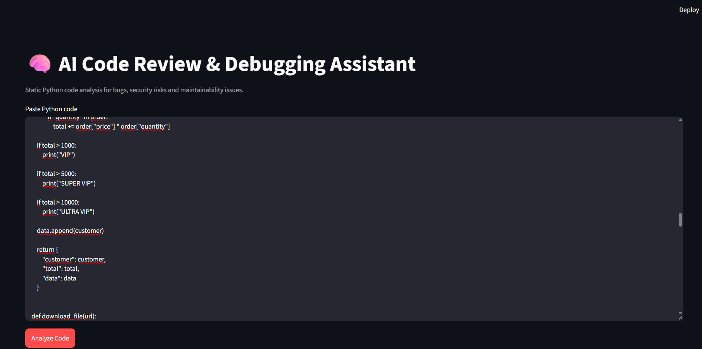

# AI Code Review Assistant

Automated Python code review and debugging assistant focused on detecting security risks, code-quality problems, maintainability issues, and common programming mistakes.

The project analyzes Python source code using static analysis techniques based on Python's Abstract Syntax Tree (AST), pattern detection, and predefined review rules.

It provides issue severity levels, explanations, improvement suggestions, a code-quality score, and an exportable Markdown report through an interactive Streamlit interface.

## Project Goals

This project demonstrates:

- Static code analysis
- Python AST analysis
- Security-oriented code review
- Code-quality analysis
- Pattern detection
- Rule-based issue classification
- Severity levels
- Automated improvement suggestions
- Code-quality scoring
- Markdown report generation
- Interactive code analysis with Streamlit
- Automated testing
- Reproducible development workflows

## Technologies

### Core

- Python
- Python AST
- Regular Expressions

### Application

- Streamlit

### Testing & Development

- pytest
- Git
- GitHub

## Main Features

The analyzer reviews Python code and identifies multiple categories of potential problems.

### Security Analysis

Examples of detectable security issues include:

- `eval()` usage
- `exec()` usage
- `subprocess` calls with `shell=True`
- Hardcoded secrets
- Hardcoded passwords or tokens
- Potential SQL injection patterns
- Unsafe command execution

### Error Handling

The analyzer can identify patterns such as:

- Bare `except:`
- Exception handling that hides errors

### Code Quality

Code-quality checks include:

- Excessive use of `print()`
- Mutable default arguments
- Long functions
- High function complexity
- Unused imports
- Files opened without context managers
- Potential maintainability issues

## Severity Levels

Detected issues are classified according to severity.

Typical levels include:

- Critical
- High
- Medium
- Low

Severity helps prioritize which problems should be fixed first.

## Code Quality Score

The application calculates a quality score based on the detected issues.

The score provides a quick summary of the overall condition of the analyzed code while the detailed results explain the individual problems.

## Review Suggestions

Each detected issue can include information such as:

- Issue type
- Severity
- Location
- Description
- Recommended improvement

This allows the application to work not only as a detector but also as a learning and debugging assistant.

## Streamlit Application

The project includes an interactive Streamlit interface where users can paste Python code and run an automated review.

The application displays:

- Code-quality score
- Detected issues
- Severity levels
- Explanations
- Suggested improvements

It also allows the analysis results to be exported as a Markdown report.

Run the application with:

```bash
python -m streamlit run app.py
```

On Windows with the project's virtual environment:

```bash
./.venv/Scripts/python.exe -m streamlit run app.py
```

## Example Issues

The analyzer can detect code such as:

```python
password = "admin123"

def calculate(values=[]):
    try:
        result = eval(input("Expression: "))
        print(result)
    except:
        pass
```

Possible findings include:

- Hardcoded credential
- Use of `eval()`
- Mutable default argument
- Bare exception handler
- Debug `print()` statement

## Testing

The project includes automated tests for the code-analysis rules.

Run the test suite with:

```bash
python -m pytest
```

Or on Windows:

```bash
./.venv/Scripts/python.exe -m pytest
```

## Screenshots

### Code Review Application



## Example Report

The application can export the results of a code review as a Markdown report.

An example report can be stored at:

```text
reports/example-code-review.md
```

## Project Structure

A typical project structure is:

```text
ai-code-review-assistant/
├── docs/
│   └── screenshots/
│       └── code-review-app.png
│
├── reports/
│   └── example-code-review.md
│
├── src/
│   └── ...
│
├── tests/
│   └── ...
│
├── app.py
├── README.md
├── requirements.txt
└── .gitignore
```

## How It Works

The review process follows a pipeline similar to:

```text
Python Code
    ↓
Source Parsing
    ↓
AST / Pattern Analysis
    ↓
Rule Evaluation
    ↓
Issue Classification
    ↓
Severity Assignment
    ↓
Quality Score
    ↓
Suggestions
    ↓
Streamlit Report
```

## Limitations

This project performs static analysis and does not execute the submitted source code as part of the review process.

The analyzer is rule-based, so it cannot understand every possible program context or guarantee that detected issues represent actual vulnerabilities.

It should be considered an automated code-review assistant rather than a replacement for professional security auditing or manual code review.

## Future Improvements

Possible future improvements include:

- Additional security rules
- More advanced complexity analysis
- Support for additional programming languages
- Custom rule configuration
- Improved code metrics
- CI/CD integration
- GitHub repository analysis
- Line-by-line code annotations
- Generative AI integration for contextual explanations and refactoring suggestions

## Project Status

Version 1.0.0 represents the first complete portfolio-ready release of the AI Code Review Assistant.